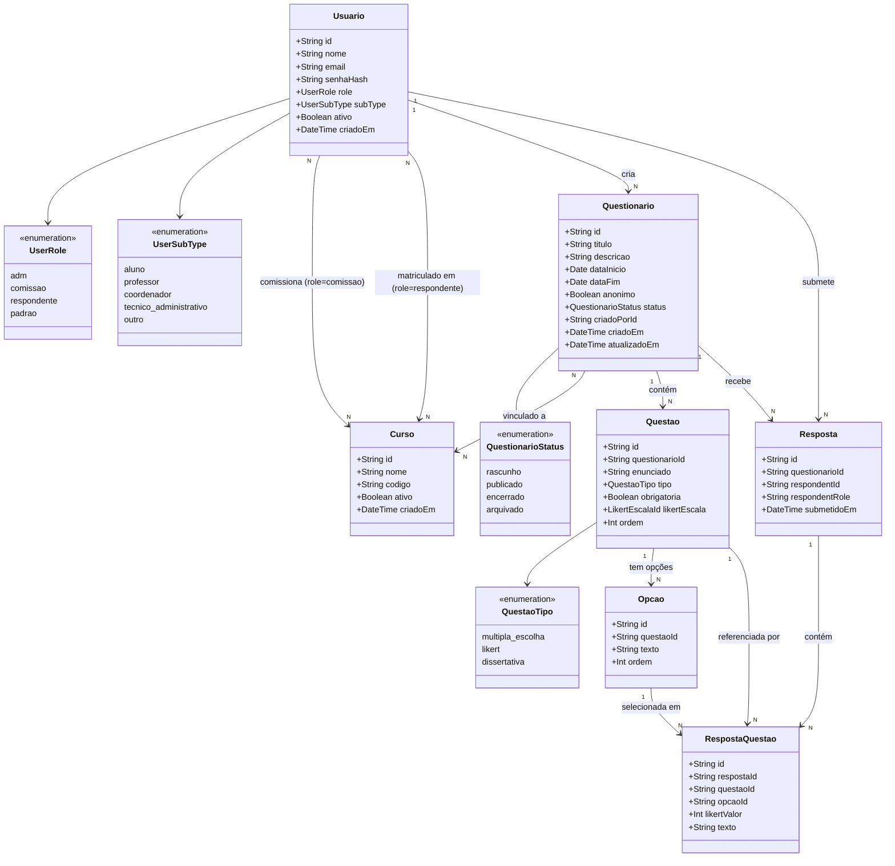
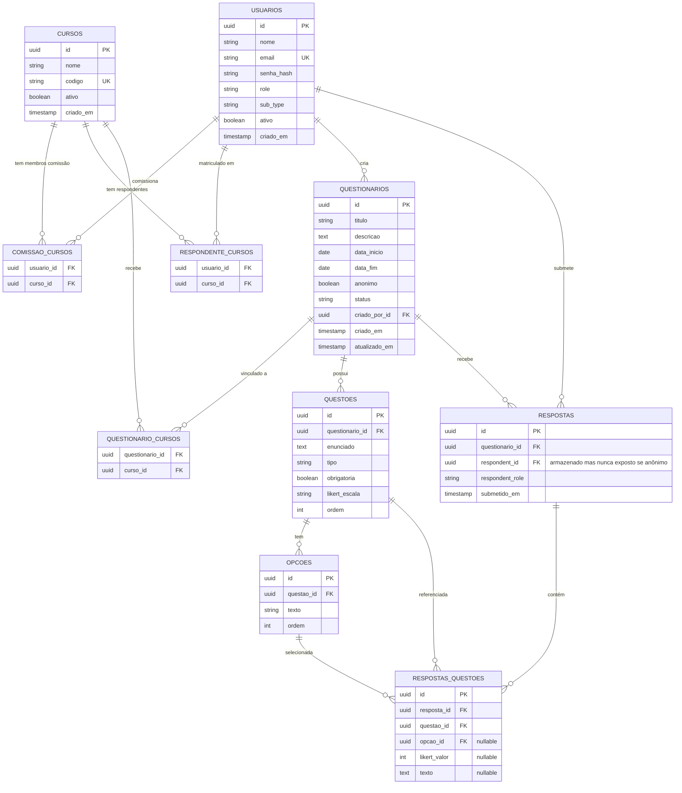
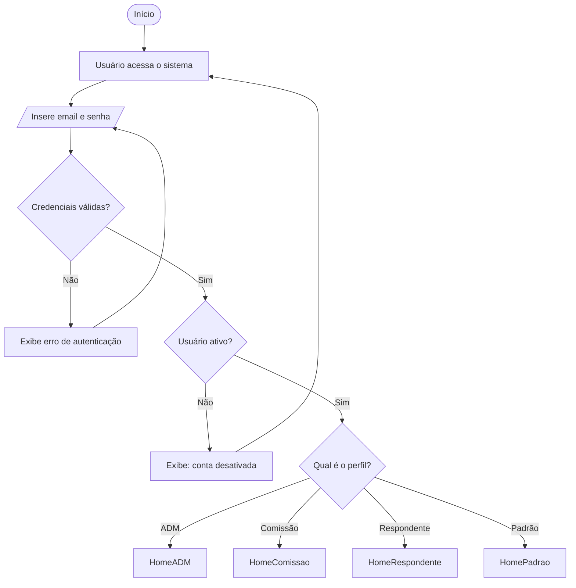
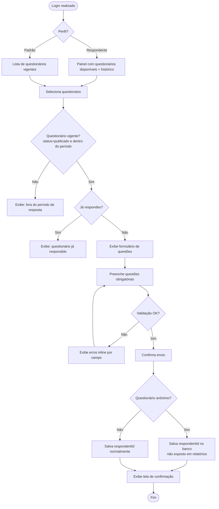
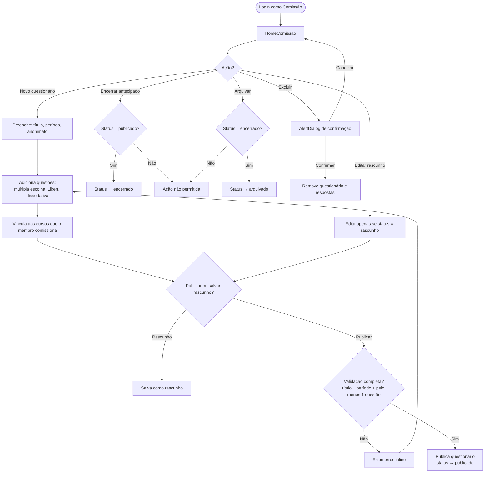
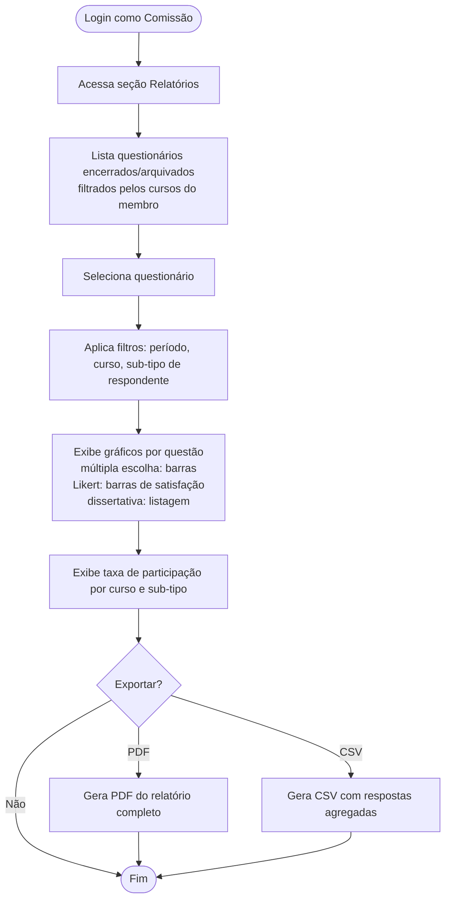
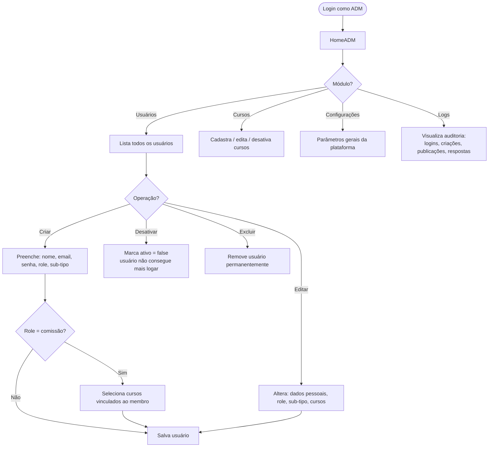

# Avaliação IFB – React + Vite + Tailwind (shadcn-style)

Projeto em React + Vite configurado com Tailwind CSS 4 e componentes no estilo **shadcn/ui** (utilizando `class-variance-authority`, `tailwind-merge`, etc.).

Este guia explica como rodar o projeto em **qualquer computador**.

---

## Requisitos

- **Node.js** (versão LTS recomendada)  
  Você pode conferir se está instalado com:

```bash
node -v
npm -v
```

---

## Como rodar o projeto pela primeira vez

1. **Clonar ou copiar o projeto**
   - Se estiver usando Git:
     ```bash
     git clone <url-do-repositorio>
     cd "avaliacao IFB"
     ```
   - Ou copie a pasta `avaliacao IFB` para o outro computador (não é necessário copiar `node_modules`).

2. **Instalar as dependências**

   Dentro da pasta `avaliacao IFB`:

   ```bash
   npm install
   ```

   Isso usa `package.json` e `package-lock.json` para instalar as mesmas versões de bibliotecas (React, Vite, Tailwind, shadcn-utils, etc.).

3. **Rodar em modo desenvolvimento**

   Ainda dentro de `avaliacao IFB`:

   ```bash
   npm run dev
   ```

   Em seguida, abra no navegador o endereço mostrado no terminal (geralmente `http://localhost:5173`).

---

## Build de produção (opcional)

Para gerar os arquivos otimizados de produção:

```bash
npm run build
```

Para pré-visualizar a build:

```bash
npm run preview
```

---

## Tecnologias principais

- **React** + **TypeScript**
- **Vite**
- **Tailwind CSS 4**
- Utilitários no estilo **shadcn/ui**:
  - `class-variance-authority`
  - `clsx`
  - `tailwind-merge`
  - `tailwindcss-animate`
  - `@radix-ui/react-slot`
  - `lucide-react`

# Arquitetura do Sistema — Avaliação IFB

**Versão:** 1.0 | **Data:** Junho/2026

---

## 1. Diagrama de Classes



---

## 2. Diagrama de Banco de Dados (ER)

> **Notas:**
> - Questionários anônimos: `respondent_id` é armazenado no banco para deduplicação (RN02), mas **nunca exposto em relatórios ou respostas da API** (RN04).
> - **Semestre/período** não é uma entidade separada. É implícito no título e nas datas de vigência do questionário (ex: "Avaliação ADS — 1º Semestre 2025").
> - **Curso** representa apenas o nome do curso (ex: "ADS"). Respondentes e membros da comissão são vinculados a cursos — o questionário define o período.



---

## 3. Fluxo de Autenticação



---

## 4. Fluxo de Resposta — Respondente e Padrão



---

## 5. Fluxo de Criação de Questionário — Comissão



---

## 6. Fluxo de Relatórios — Comissão



---

## 7. Fluxo de Gestão — ADM



---

## 8. Regras de Negócio Críticas

| Código | Regra | Impacto no Backend |
|--------|-------|-------------------|
| RN01 | Resposta só dentro do período de vigência | Validar `dataInicio ≤ hoje ≤ dataFim` na API |
| RN02 | Uma resposta por usuário por questionário | `UNIQUE(respondent_id, questionario_id)` — aplicado sempre, inclusive anônimos |
| RN03 | Questionário publicado não é editável | API recusa PUT se `status ≠ rascunho` |
| RN04 | Anônimo: `respondent_id` não exposto | Armazenado no banco para deduplicação, nunca retornado pela API |
| RN05 | Só ADM cria e altera usuários | Guard de autorização por role |
| RN07 | Relatórios disponíveis só após encerramento | Filtrar por `status IN (encerrado, arquivado)` |
| RN09 | Padrão: acesso restrito a login/logout/resposta | Guard de rota na API e no frontend |

---

## 9. Visibilidade por Perfil — Resumo

| Recurso | ADM | Comissão | Respondente | Padrão |
|---------|-----|----------|-------------|--------|
| Gerenciar usuários | ✅ | ❌ | ❌ | ❌ |
| Gerenciar cursos | ✅ | ❌ | ❌ | ❌ |
| Criar questionários | ❌ | ✅ (cursos vinculados) | ❌ | ❌ |
| Ver relatórios | ❌ | ✅ (cursos vinculados) | ❌ | ❌ |
| Responder questionários | ❌ | ❌ | ✅ | ✅ |
| Ver histórico | ❌ | ❌ | ✅ | ❌ |
| Painel de participação | ❌ | ✅ (cursos vinculados) | ❌ | ❌ |
